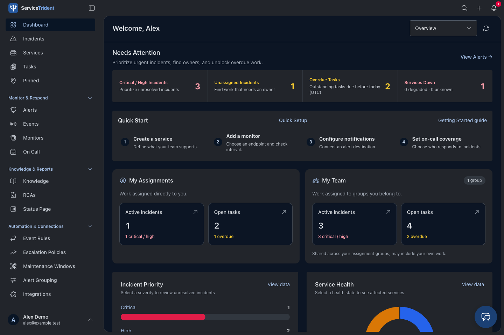
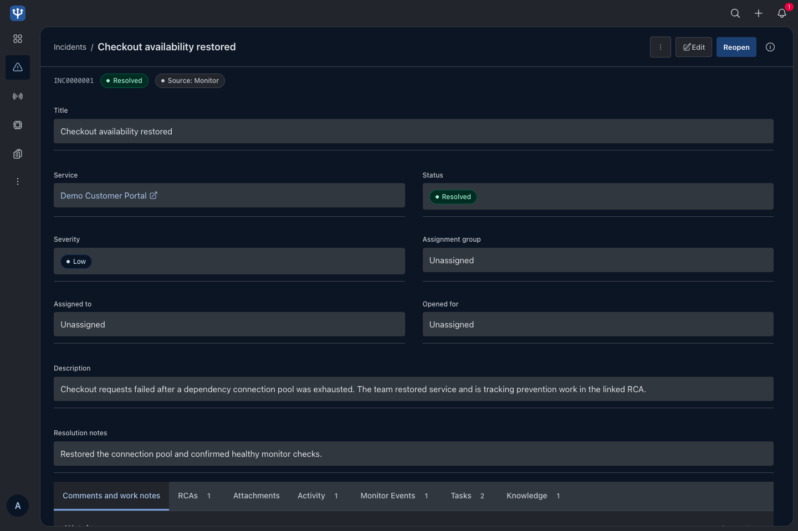
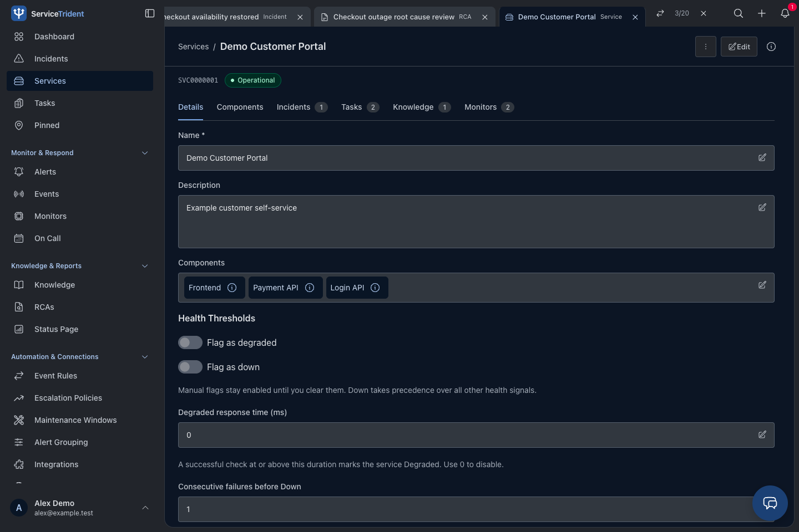
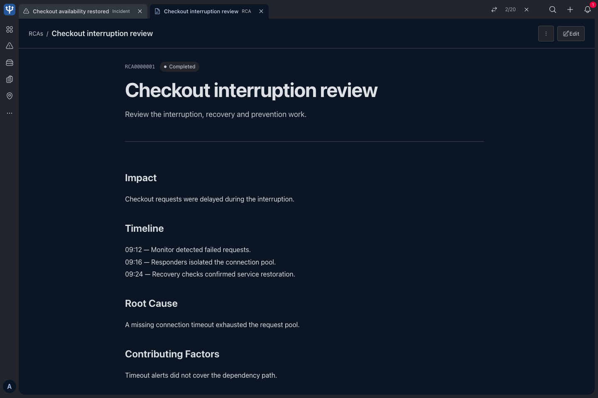
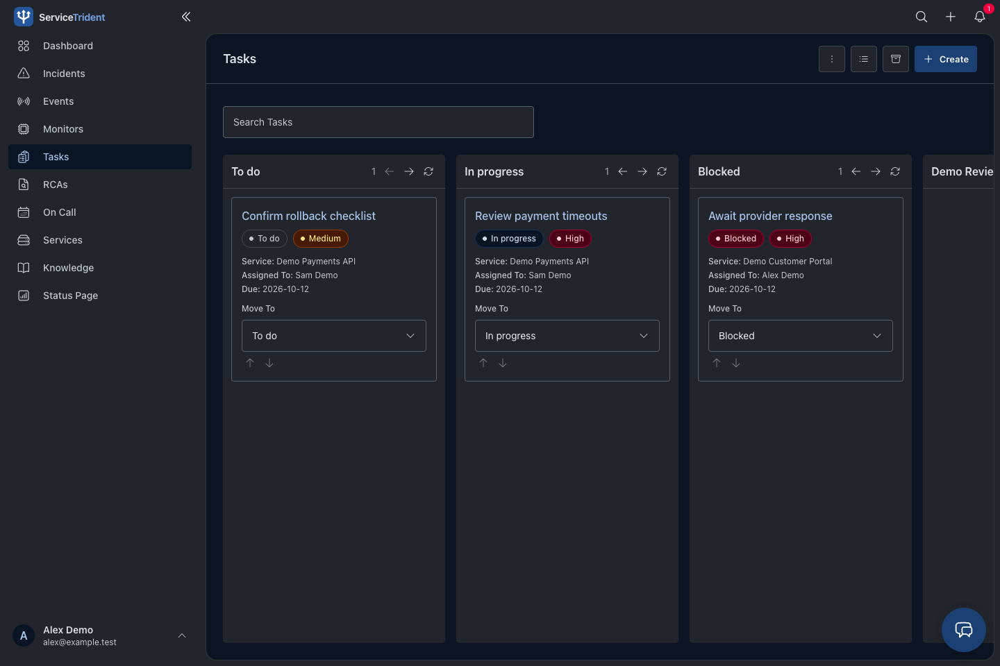
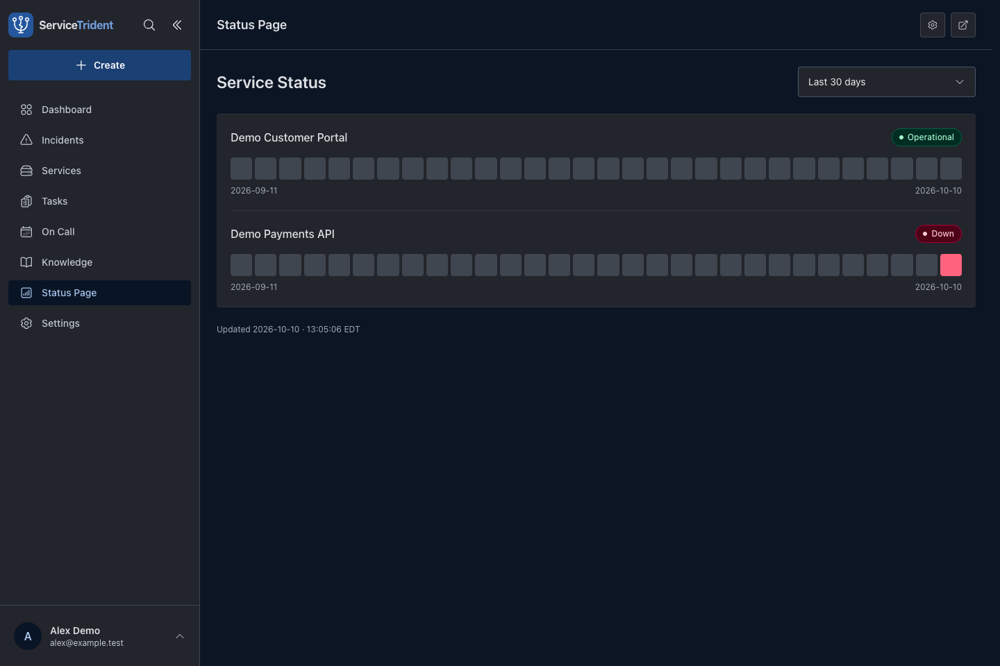
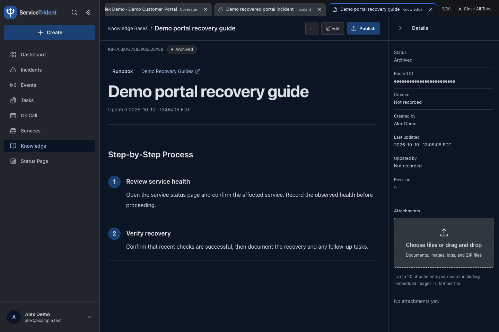

# ServiceTrident

ServiceTrident is a free, open source application for service monitoring and incident response. It brings services, health checks, incidents, tasks, knowledge, and on-call coverage into one place that developers and small teams can run themselves.

> **Status: Alpha** — ServiceTrident is under active development and intended for evaluation, development environments, and small-team pilots. Expect changing features and occasional bugs. Back up your data before upgrading, and do not rely on it as your only system for critical monitoring or incident response.

## Why I built this

After years of working with enterprise platforms, I wanted to take the parts that help teams do their work and make them available in a smaller, more approachable tool. Knowing what a service depends on, who owns it, what is broken, and what happened last time should be within reach of a team without a large platform budget.

I built ServiceTrident to bring that experience together in something useful that I could share for free. My goal is to give developers and small teams a place to manage their services and respond to problems without requiring a dedicated platform team just to get started. You can host it yourself, inspect the code, and adapt it to the way you work.

Note: ServiceTrident's code was generated and refined with AI assistance, including ChatGPT and Codex.

## What you can do

- Monitor HTTP/HTTPS services and keyword conditions, receive external events, triage correlated alerts, and investigate linked incidents through related lists.
- Coordinate incident response with assignments, comments, work notes, mentions, watchers, and notifications.
- Organize tasks with board and list views. Pin frequently used records in personal groups with record type and service context; rename groups on Pinned.
- Schedule on-call coverage and track root cause analyses.
- Maintain knowledge articles and runbooks, and share service health through a public status page.
- Connect communication and ticketing tools, configure identity providers, and give external systems scoped record-creation access.
- Use optional AI assistance with your own provider account for authorized search, drafts, and confirmed record actions.

Workspaces include role-based access, configurable forms, audit history, dashboards, and record exports. Open **Help** from the profile menu for essential workflows and configuration guidance.

## App preview

### Overview dashboard



### Incident record



### Service record



### Root cause analysis



### Tasks board



### Status page

History uses your profile timezone in the app and your browser timezone on public pages. The current day’s percentage covers checks collected so far. Local-day history uses retained checks (up to 30 days); older UTC summaries remain available only in UTC.



### Knowledge runbook



## Start with Docker

Install [Git](https://git-scm.com/install/) and [Docker with Compose](https://docs.docker.com/get-started/get-docker/), then start Docker. The containers supply Node.js, the database, and Redis; keep port **8090** available.

Clone the repository and enter its directory:

```sh
git clone https://github.com/danthedevman/ServiceTrident.git ServiceTrident
cd ServiceTrident
cp .env.example .env
docker compose up -d --build --wait
```

These commands work in macOS/Linux shells and Windows PowerShell. In Windows Command Prompt, use `copy .env.example .env` instead of `cp .env.example .env`.

Wait for the build and startup to finish, then open **<http://127.0.0.1:8090>** and create an account. The API health endpoint is <http://127.0.0.1:8090/api/health>.

The default setup runs the frontend, Express API, check workers, scheduler, MongoDB, and Redis as separate containers. Data and the integration-encryption key are kept in persistent volumes.

For an existing installation, keep your current `.env` and volume settings. Do not copy the example over working credentials or database settings.

```sh
# Inspect running services and recent logs
docker compose ps
docker compose logs --tail=100 api workers scheduler

# Rebuild and apply application changes
docker compose up -d --build --wait app api workers scheduler

# Stop the stack while keeping its data
docker compose down
```

**Do not use `docker compose down -v` unless you intend to delete stored data.** A production frontend is compiled into its image, so source changes need a rebuild. Use development mode below for hot reload.

### Try the app

Use **Quick Setup** on Overview or in the global **Create** modal to create a service and monitor; notifications and on-call coverage are optional. Or open **Settings → Demo Data → Add Demo Data** to explore sample records and notifications. Existing demo batches must be deleted and recreated to receive newly added examples. Demo monitors are paused and sample alerts do not send external messages. Enable Demo AI separately to try simulated chat examples without a provider account.

Tasks opens a workspace task board with a list view available.

Use bundled **Help** for monitor authentication, integration setup, record workflows, permissions, and demo cleanup.

## Integrations and AI

Admins open **Event Rules**, **Escalation Policies**, **Maintenance Windows**, **Probe Agents**, **Alert Grouping**, and **Integrations** from the main navigation (under **More** when collapsed). Supported connections include SMTP email, Slack, Microsoft Teams, Discord, PagerDuty, ServiceNow, Jira Cloud, GitHub Issues, and webhooks. Configure only the destinations your team needs, and verify delivery before relying on them. Third-party accounts, hosting, and delivery may incur charges.

Optional OpenAI and Claude integrations use your own API credentials. AI respects workspace permissions; proposed changes require confirmation. Review generated content before saving, and account for provider usage costs. Demo AI uses fixed examples and simulated actions.

External systems can submit deduplicated operational events and create incidents, tasks, and knowledge through scoped service accounts using API keys or OAuth client credentials. See the [External API guide](docs/external-api.md).

Event routing with previews, acknowledgment-based escalation, expiring maintenance windows, delivery retries, independent probe confirmation and operational reports help teams manage incoming signals. See the [operational automation guide](docs/operational-automation.md) for setup and limits.

## Hosting and operations

MongoDB is the default; PostgreSQL is also supported. Redis is required with either database. Switching database providers does not migrate data. See [database setup and backups](docs/database-backends.md).

For remote deployments, use HTTPS, configure the exact `APP_ORIGIN` and secure cookies, and keep databases and Redis private. Back up the database, integration-encryption key, and persistent Redis data; test restoration before depending on the installation.

Monitoring currently checks public HTTP/HTTPS endpoints on standard ports. Private and reserved addresses are blocked. ServiceTrident is alpha and does not include app-native MFA, SAML/SCIM provisioning, SMS/voice paging, multi-step escalation, or a hosted availability guarantee.

- [Operations, upgrades, and recovery](docs/operations.md)
- [Render deployment and public status-page domains](docs/deployment.md)
- [Scaling and workload planning](docs/scaling.md)
- [Security review and verification limits](docs/security-review.md)
- [Audit history](docs/audit-log.md)

## Local development

The stack uses React and Tailwind CSS, Express with ESM, the MongoDB driver or PostgreSQL adapter, and BullMQ with Redis. The code is JavaScript; Node.js 24 or newer is required.

For development outside the application containers, install [Node.js 24 LTS with npm](https://nodejs.org/en/download), alongside Git and Docker. Confirm your installation with `node --version` and `npm --version`. Run the following commands from the cloned repository with your `.env` file in place:

```sh
npm ci
docker compose -f compose.yaml -f compose.dev.yaml up -d mongo redis
```

Run each process in its own terminal:

```sh
APP_ORIGIN=http://localhost:5173 npm run dev:api
npm run dev:app
npm run dev:workers
npm run dev:scheduler
```

Open <http://localhost:5173>. Vite proxies `/api` to port 3000 and reloads frontend changes during development. Do not run local and Docker workers/schedulers against the same queue unintentionally.

Local API and workers share `.servicetrident/integration.key` automatically. If overriding its location, give both processes the same absolute `INTEGRATION_KEY_FILE`. Never commit that key, `.env`, database backups, or real provider credentials.

### Repository layout

```text
api/       Express API, authentication, routes, and workspace authorization
app/       React application, shared UI, forms, and query caching
workers/   Check execution, scheduling, notification delivery, and maintenance
shared/    Validation, form schemas, integration rules, and persistence adapters
test/      Unit tests and disposable-database integration tests
docs/      Architecture, deployment, and operational guidance
```

See [architecture](docs/architecture.md) for conventions when extending the app.

### Checks and formatting

```sh
npm run lint
npm test
npm run build
npm run format:check

docker compose -f compose.yaml -f compose.test.yaml run --build --rm test
```

`npm run format` applies the shared Prettier rules. Integration tests use isolated database names and clean up their test data. Provider tests use mocked requests; they do not send real notifications or establish compatibility with every provider account configuration.

## Contributing

Open an issue with reproduction steps and expected behavior. Keep changes focused, preserve authorization and validation, and update relevant Help, documentation, and tests. See [architecture](docs/architecture.md) and [AGENTS.md](AGENTS.md) for development conventions.

Never share credentials or private workspace data. Use GitHub private vulnerability reporting if enabled, or arrange a private channel with the maintainer, for security issues.

## License

Available under the [MIT License](LICENSE). Hosting and third-party services remain your responsibility.
