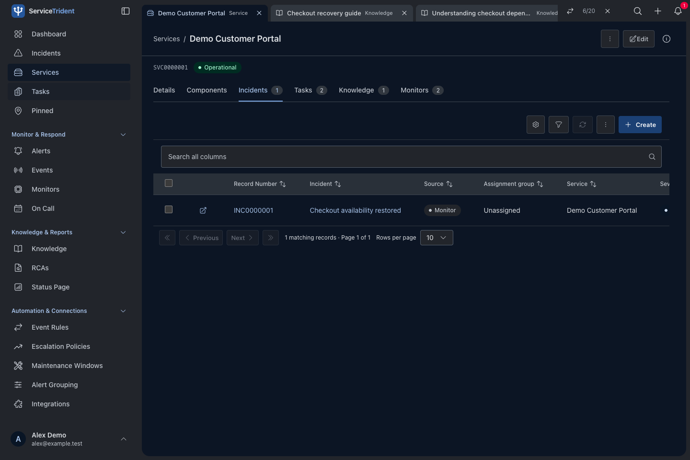
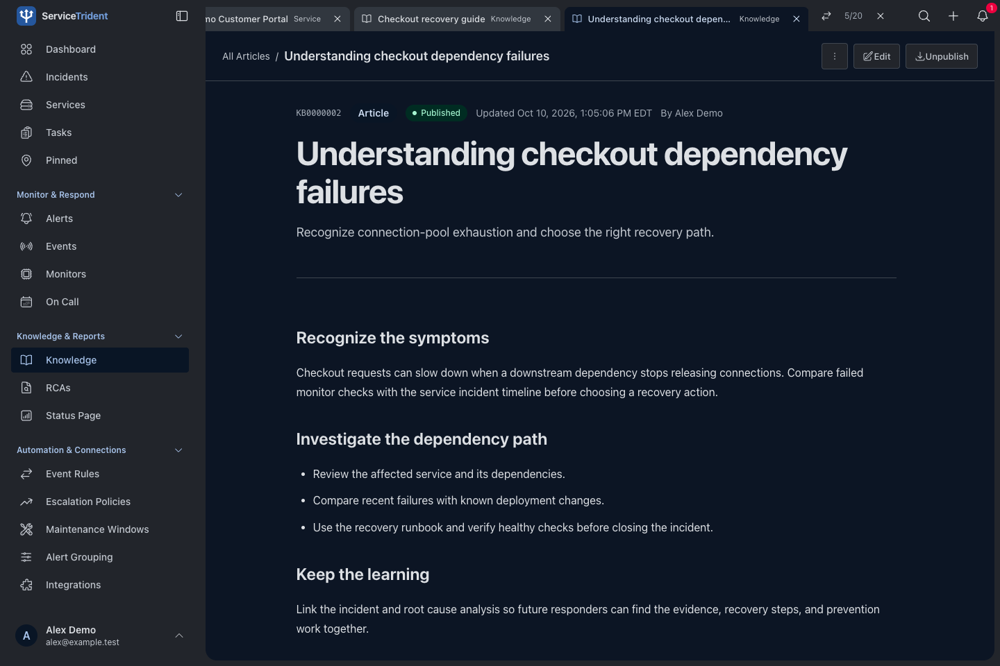
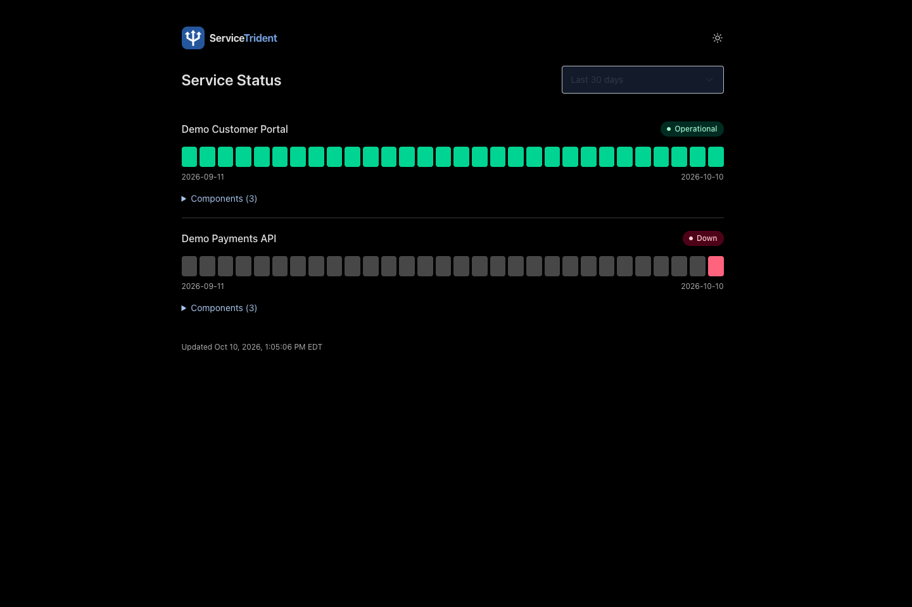

# ServiceTrident

ServiceTrident is a free, open source platform for service monitoring and incident response. It brings service health, operational signals, response coordination, and shared knowledge together for developers and small teams.

> **Alpha:** ServiceTrident is under active development. Expect changing features and occasional bugs. Evaluate it before relying on it for critical operations.

## Why I built this

After years of working with enterprise platforms, I wanted to make the useful parts available in a smaller, more approachable tool. Understanding what a service depends on, who owns it, what is broken, and what happened last time should be within reach of a team without a large platform budget.

ServiceTrident brings that experience together in something teams can host themselves, inspect, and adapt. The code was generated and refined with AI assistance, including ChatGPT and Codex.

## What it brings together

- **Monitoring:** Website and API health checks, service dependencies, and component visibility.
- **Signal aggregation:** Operational events from monitoring and external systems in one place.
- **Incident response:** Alert triage, ownership, on-call coverage, and coordinated follow-up.
- **Shared knowledge:** Runbooks, knowledge articles, tasks, and root cause analysis.
- **Visibility:** Dashboards, operational reporting, and public service status pages.
- **Connections:** Communication and ticketing integrations, an external API, and optional AI assistance.

ServiceTrident is self-hosted and supports MongoDB or PostgreSQL with Redis. Hosting and third-party services may incur costs.

## Preview

Work across linked records and their related views.

Keep investigation notes and recovery knowledge close at hand.

Share service health through a dedicated public page.

## Learn more

Visit the [ServiceTrident website](https://servicetrident.com) for the product overview. Bundled **Help** covers app workflows, configuration, and permissions.

Technical documentation:

- [Installation and development](docs/getting-started.md)
- [Deployment](docs/deployment.md)
- [Operations and recovery](docs/operations.md)
- [Database backends](docs/database-backends.md)
- [Architecture](docs/architecture.md)
- [External API](docs/external-api.md)
- [Security review](docs/security-review.md)

## Contributing

Issues and focused contributions are welcome. See [AGENTS.md](AGENTS.md) for repository conventions. Keep credentials and private workspace data out of issues and contributions; arrange a private channel with the maintainer for security reports.

## License

[MIT](LICENSE).
